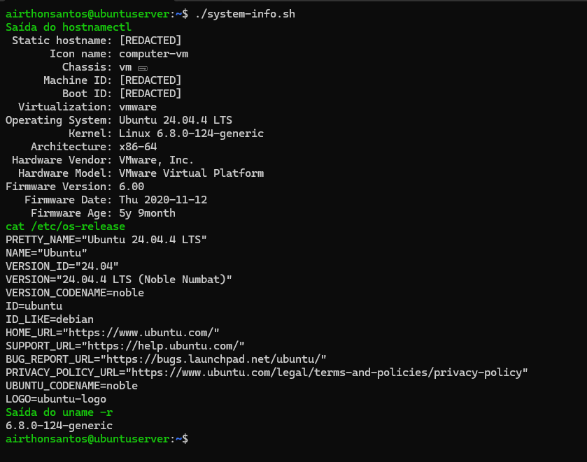
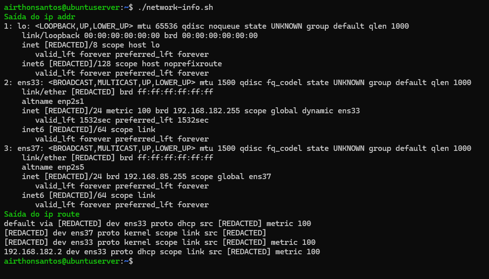
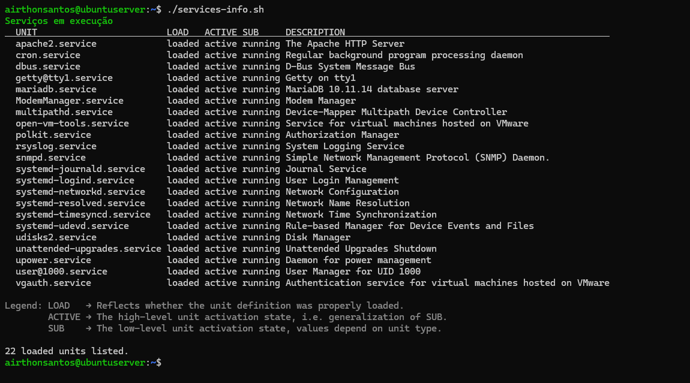
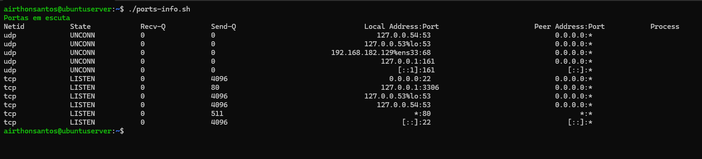
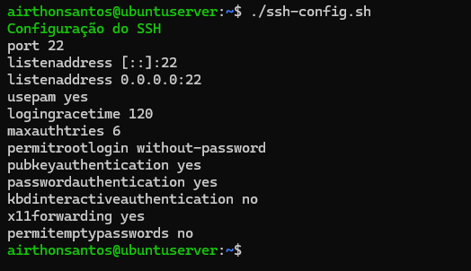
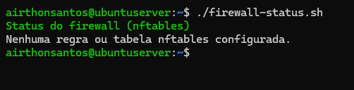
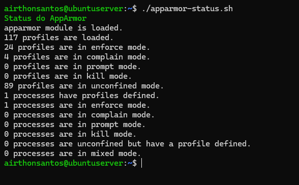
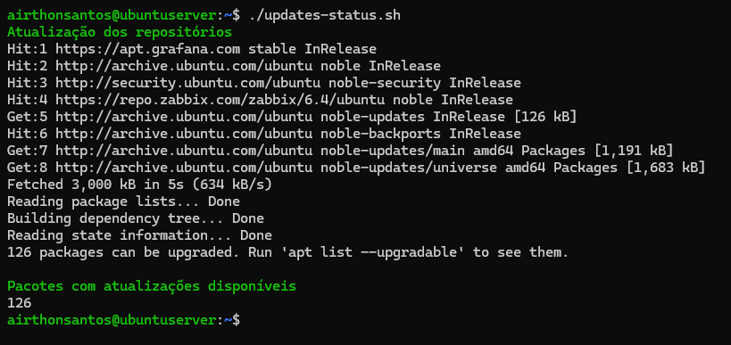

# Baseline do Servidor
## 🎯 Objetivo

O objetivo desta etapa foi estabelecer um baseline do servidor, documentando todo seu estado inicial antes da aplicação de qualquer medida de hardening. Esse levantamento servirá como referência para comparação dos resultados obtidos ao longo do projeto, permitindo identificar alterações realizadas na configuração do sistema e avaliar seus impactos no ambiente.

## Levantamento Inicial

Durante essa etapa, coletei informações relacionadas ao sistema operacional, configuração de rede, serviços em execução, portas expostas, firewall, configuração do SSH, estado do AppArmor e o estado das atualizações.

## Reprodução das Evidências

Para tornar o processo de coleta reproduzível, desenvolvi scripts dedicados para cada evidência do baseline. Além de padronizar a coleta das informações, alguns scripts realizam a sanitização da saída, removendo dados que não agregam valor à documentação e que poderiam expor informações sensiveis do ambiente.

Os scripts usados nesta etapa estão disponíveis em [`scripts/01-baseline/`](../scripts/01-baseline/).

## Estado Inicial do Servidor
### Informações do sistema

As primeiras informações coletadas foram relacionadas à identificação e às características básicas do sistema, incluindo hostname, versão do Ubuntu Server, versão do kernel e arquitetura da máquina.

  
📂 Clique aqui para ver as informações do sistema

   
    

      
    

### Interfaces de rede

Em seguida, realizei o levantamento das configurações de rede, incluindo as interfaces disponíveis, endereços IP e o gateway. Essas informações são relevantes, pois permitem identificar as interfaces usadas pelo servidor, sua forma de conectividade e os caminhos de rede disponíveis antes da aplicação de qualquer medida de hardening.

  
📂 Clique aqui para ver as interfaces de rede

   
    

      
    

O servidor possui duas interfaces de rede, com funções distintas dentro do laboratório. Uma delas é usada para conectividade externa por meio da rede **NAT**, enquanto a outra é destinada à comunicação com a rede **Host-only**, permitindo acesso remoto via SSH com o host Windows. Essa separação também será considerada durante a configuração das políticas de firewall, permitindo avaliar posteriormente quais tipos de tráfego devem ser permitidos em cada contexto de rede.

### Serviços ativos

Na sequência, realizei o levantamento dos serviços em execução para identificar quais componentes estavam ativos e entender sua finalidade no ambiente. Essa informação será útil para avaliar quais serviços devem ser mantidos, restringidos ou desativados, reduzindo a superfície de ataque sem comprometer as funções necessárias do servidor.

  
📂 Clique aqui para ver os serviços em execução

   
    

      
    

Os serviços identificados refletem tanto componentes essenciais do sistema quanto aplicações instaladas para outras funções no servidor. Entre os serviços de maior relevância, estão o **Apache2**, responsável pelo serviço HTTP, o **MariaDB**, usado como servidor de banco de dados, o **SNMP (`snmpd`)**, usado anteriormente para monitoramento, e o **SSH**, responsável pelo acesso remoto ao sistema.
### Portas Abertas

Realizei uma análise dos sockets TCP e UDP ativos para identificar as portas usadas pelos serviços em execução e verificar em quais interfaces esses serviços estavam vinculados.

  
📂 Clique aqui para visualizar as portas abertas

   
    

      
	

A análise identificou serviços como **SSH (22/TCP)** e **Apache (80/TCP)** acessíveis pela rede, enquanto serviços como **MariaDB (3306/TCP)** e **SNMP (161/UDP)** estavam vinculados ao loopback, não estando diretamente expostos à rede. Essa distinção é relevante para o processo de hardening, pois a superfície de exposição de um serviço depende não apenas da porta usada, mas também do endereço ou interface na qual o serviço está escutando.

### Configuração do SSH

O levantamento também abrangeu as configurações atuais do serviço SSH, com foco em parâmetros relacionados à autenticação, acesso remoto e exposição do serviço.

O SSH é um dos principais mecanismos de administração remota do servidor e, consequentemente, um componente relevante da sua superfície de ataque. Neste laboratório, ele possui uma função importante por ser usado para administrar o servidor a partir do host Windows. Por esse motivo, suas configurações serão revisadas durante o processo de hardening, considerando aspectos como métodos de autenticação, privilégios administrativos, acesso de usuários e outros parâmetros relacionados à segurança do serviço.

  
📂 Clique aqui para visualizar as configurações do SSH

   
    

      
    

### Firewall

Analisei a configuração do firewall para verificar a existência de políticas de filtragem de tráfego. No momento da coleta, não havia tabelas ou qualquer regra configurada no `nftables`, indicando que o sistema não possuía uma política de filtragem.

  
📂 Clique aqui para visualizar o status do firewall

   
    

      
    

A ausência de regras de filtragem deve ser analisada em conjunto com o levantamento das portas e serviços ativos realizado antes. Embora alguns serviços estivessem vinculados apenas ao endereço de loopback, serviços como o **SSH (22/TCP)** e o **Apache (80/TCP)** estavam acessíveis pelas interfaces de rede do servidor. Essa configuração será usada como referência durante o hardening.

A política de filtragem será definida considerando os serviços necessários ao ambiente e as interfaces de rede identificadas no baseline, aplicando o princípio de **menor exposição** e permitindo somente o tráfego necessário para o funcionamento e a administração do servidor.

### Apparmor

O AppArmor foi analisado para verificar o estado inicial do mecanismo de controle de acesso obrigatório (MAC — Mandatory Access Control) presente no Ubuntu. Diferentemente das permissões tradicionais do sistema de arquivos, o AppArmor permite restringir as ações que determinados processos podem executar com base em perfis de segurança.

Essa informação é relevante, porque o AppArmor constitui uma camada adicional de proteção aos serviços executados no servidor. Seu estado atual será considerado durante as etapas de hardening e usado posteriormente para validar eventuais alterações nos perfis e nos modos de aplicação das políticas.

  
📂 Clique aqui para visualizar o estado do AppArmor

   
    

      
    

O AppArmor encontra-se habilitado no sistema, com **117 perfis carregados**. Desses, **24 estão em modo `enforce`** e **4 em modo `complain`**. Foi identificado ainda um processo com perfil definido, o `rsyslogd`, atualmente executado em modo `enforce`. Esse estado será usado como referência para as etapas posteriores de hardening e validação.
### Estado das atualizações do sistema

Por fim, realizei uma verificação do estado de atualização do sistema e das fontes de pacotes configuradas. A manutenção de pacotes atualizados é um componente importante do hardening, pois atualizações podem incluir correções de segurança, correções de bugs e melhorias de estabilidade.

  
📂 Clique aqui para visualizar o estado das atualizações do sistema

   
    

      
    

Durante a verificação, identifiquei **126 pacotes com atualizações disponíveis**. Esse estado foi registrado como parte do baseline, uma vez que a aplicação posterior dessas atualizações poderá modificar componentes do sistema e influenciar os resultados das auditorias posteriores.

Também identifiquei repositórios APT relacionados ao ambiente de monitoramento usado anteriormente, incluindo os repositórios do **Zabbix** e **Grafana**. Embora os respectivos serviços estejam atualmente desativados, essas fontes de pacotes permanecem configuradas no sistema. Sua necessidade será avaliada durante a etapa de limpeza e hardening, considerando o princípio de manter somente componentes e fontes de software necessários ao servidor.

## 📌 Resultado

Com a coleta das informações concluída, foi estabelecido o baseline do servidor, registrando seu estado inicial antes da aplicação dos controles de hardening.

O levantamento documentou aspectos relacionados ao sistema operacional, configuração de rede, serviços em execução, portas e interfaces de rede, configuração do SSH, firewall, AppArmor e estado das atualizações. Essas informações servirão como referência para acompanhar as alterações realizadas ao longo do projeto e comparar o estado do servidor antes e após a implementação das medidas de segurança.

A próxima etapa será a realização de uma **auditoria de segurança com o Lynis**. A análise permitirá identificar configurações que possam representar riscos, controles de segurança ausentes e oportunidades de melhoria. Esses resultados serão usados para definir quais medidas de segurança serão aplicadas durante o processo de hardening.