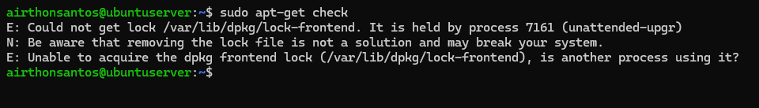
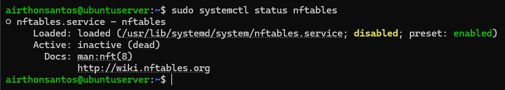
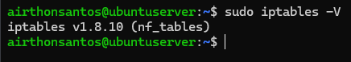
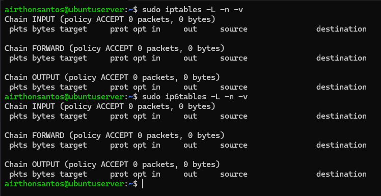

# Auditoria com Lynis

## 🎯 Objetivo

Nesta etapa, realizei uma auditoria de segurança com o Lynis, com o objetivo de identificar configurações inadequadas, controles de segurança ausentes e possíveis pontos de melhoria antes da aplicação das medidas de hardening.

## Instalação do Lynis

O Lynis é uma ferramenta open source de auditoria de segurança para sistemas Linux. Ele executa centenas de testes sobre a configuração do sistema e apresenta os resultados como *warnings* (problemas que merecem atenção), *suggestions* (melhorias recomendadas) e um **Hardening Index**, uma pontuação de 0 a 100. Ele apenas reporta o que encontra, sem aplicar correções.

Como ele não estava instalado, realizei a instalação a partir do comando abaixo:

```
sudo apt install lynis
```

A versão instalada foi a **3.0.9**. Existe uma versão mais recente, mas mantive a 3.0.9 durante todo o projeto para preservar a reprodutibilidade dos resultados.

## Auditoria inicial

Executei a auditoria, depois da criação do baseline e antes da aplicação de qualquer medida de hardening. O resultado funciona, portanto, como o ponto de partida para a comparação com a auditoria final. O comando usado para iniciar a auditoria foi:
```
sudo lynis audit system
```

O Hardening Index deve ser lido como um indicador de evolução, e não como uma nota absoluta de segurança. O resultado geral foi o seguinte:

| Indicador          |                          Resultado |
| ------------------ | ---------------------------------: |
| Testes realizados  |                                266 |
| Hardening Index    |                             **59** |
| Warnings           |                              **3** |
| Suggestions        |                             **50** |
| Firewall detectado | Sim (módulo carregado, sem regras) |
| Malware scanner    |                                Não |
| AppArmor           |                         Habilitado |

A saída completa da auditoria foi preservada em `assets/02-lynis/audit-before.txt`. Este README apresenta apenas os resultados relevantes, nos quais foram identificados três warnings: **PKGS-7390**, **PKGS-7392** e **FIRE-4512**. Analisei cada um para entender o que eles representavam.
## Investigação dos Warnings
### PKGS-7390

O primeiro warning foi o PKGS-7390, relacionado a uma falha na execução do `apt-get check`, o que poderia indicar algum problema no estado do banco de pacotes ou das dependências. Para determinar se o erro indicava uma inconsistência persistente ou algo pontual, executei a verificação manualmente. A primeira execução reproduziu exatamente o problema:

<details>
  <summary>📂 Clique aqui para ver o problema envolvendo o apt-get</summary>
  <br>
    <p align="center">
      
    </p>
</details>

A análise do erro mostrou que o `dpkg` estava bloqueado pelo processo `unattended-upgr`, responsável pela execução automática de atualizações do sistema. A partir disso pude concluir que o erro indicava um **lock temporário do gerenciador de pacotes**, e não necessariamente uma inconsistência no banco de dados. Após confirmar a conclusão do processo `unattended-upgr`, o `apt-get check` executou normalmente, sem apresentar erros.

> [!NOTE]
> Nessa etapa, descobri que o Ubuntu Server vem com o `unattended-upgrades` ativo por padrão, e eu não havia considerado isso ao definir que o servidor ficaria sem atualizações. O processo estava em execução durante a auditoria, e o número de atualizações pendentes caiu de 126 no baseline para 42 nesta etapa, o que indica que o sistema recebeu atualizações automáticas entre as duas coletas. Por isso, resolvi desativar o serviço para o restante do projeto.

### PKGS-7392

O warning PKGS-7392 ("Found one or more vulnerable packages") indica que existem atualizações de segurança pendentes. No contexto do Lynis, "vulnerable packages" significa pacotes com atualização de segurança disponível, e não vulnerabilidades confirmadas.

Esse alerta era esperado, já que a intenção era manter o servidor sem atualizações até a etapa seguinte do projeto. Porém, o `unattended-upgrades` impediu que o sistema ficasse de fato congelado, mas ainda restavam atualizações pendentes, o que acabou gerando esse warning.

### FIRE-4512

O último warning foi o FIRE-4512. A verificação buscou determinar se havia algum mecanismo de filtragem de tráfego ativo e qual tecnologia estava em uso.

Primeiro, consultei o conjunto de regras do `nftables`, por meio do comando abaixo:

```
sudo nft list ruleset
```

O comando não retornou nenhuma tabela, chain ou regra. Em seguida, verifiquei o estado do serviço:

<details>
  <summary>📂 Clique aqui para ver o status do nftables</summary>
  <br>
    <p align="center">
      
    </p>
</details>

O serviço está inativo (`inactive (dead)`) e desabilitado (`disabled`), ou seja, nenhuma regra é carregada automaticamente na inicialização. Como o Ubuntu usa o `iptables` como camada de compatibilidade sobre o `nf_tables`, verifiquei também o backend utilizado:

<details>
  <summary>📂 Clique aqui para ver a versão do iptables</summary>
  <br>
    <p align="center">
      
    </p>
</details>

O `iptables -V` confirmou o backend `nf_tables`. Portanto, não há dois firewalls independentes competindo: o `iptables` é apenas uma camada de compatibilidade (`iptables-nft`) sobre o mesmo mecanismo. Por isso, as regras IPv4 e IPv6 vistas por essa camada confirmam o mesmo estado:

<details>
  <summary>📂 Clique aqui para ver as regras IPv4 e IPv6 do iptables</summary>
  <br>
    <p align="center">
      
    </p>
</details>

Ambos apresentaram política `ACCEPT` e nenhuma regra de filtragem. O alerta FIRE-4512 foi confirmado: o servidor não possuía regras de filtragem de tráfego, e o serviço `nftables` estava inativo e desabilitado. Essa condição será tratada nas próximas etapas do hardening, com uma política de filtragem adequada aos serviços necessários.

## 📌 Resultado

A auditoria inicial identificou três warnings: PKGS-7390, PKGS-7392 e FIRE-4512.

O PKGS-7390 foi um evento pontual: um lock temporário do gerenciador de pacotes, causado pelo `unattended-upgrades`. O PKGS-7392 era esperado, já que as atualizações do sistema foram deixadas para uma etapa posterior do projeto. Já o FIRE-4512 foi confirmado, pois o servidor não possuía regras de filtragem de tráfego e o serviço `nftables` estava inativo e desabilitado; por isso será tratado na etapa seguinte, a fase de controles.

Dessa forma, a auditoria não foi tratada apenas como uma coleta de warnings, mas como uma etapa de validação e investigação dos resultados apresentados pelo Lynis.


